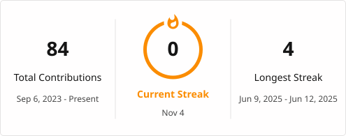

<!-- HEADER SVG CON DEGRADADO E IMPACTO VISUAL -->

<h3 align="center">Systems Engineer | Backend & Data Architecture | Scientific Simulation & Research</h3>

  
  
  

---

### About Me

Software Engineer driven by curiosity, complex problem-solving, and clean software architecture. My work bridges high-performance backend systems, transactional data architectures, and scientific computing with an ambition to pursue advanced graduate studies/PhD.

- **Currently Building:** Custom 3D Graphics Engine & Math Utility Library in **Go / OpenGL**.
- **Research Focus:** Scientific simulation using Monte Carlo methods and probabilistic modeling.
- **Algorithmic Passion:** Graph theory (academic scheduling algorithms), search algorithms, and cellular automata.
- **Engineering Philosophy:** Clean Architecture, SOLID Principles, DDD, and Agile (SCRUM).

---

### Tech Stack

#### Languages & Core Technologies

#### Frameworks & Databases

---

### GitHub Analytics & Streak

  
  

 

  

---

### Featured Projects

| Project / Research | Description | Tech Stack |
| :--- | :--- | :--- |
| **Monte Carlo Simulation Thesis** | Modeling real-world environments and complex statistical measurements. | `Python` `R` `MATLAB` |
| **3D Graphics Engine & Math Lib** | Low-level matrix math library (`*Mat4`) and OpenGL shader implementations. | `Go` `OpenGL` `C++` |
| **Academic Enrollment System** | Graph coloring algorithms for optimal course registration and conflict resolution. | `Java` `Algorithms` `SQL` |
| **Family Business ERP Logic** | High-performance transactional DB design handling sales, purchasing, and stock integrity. | `PostgreSQL` `REST APIs` `Spring` |

---

  <i>"Simplicity is prerequisite for reliability." — Edsger W. Dijkstra</i>

